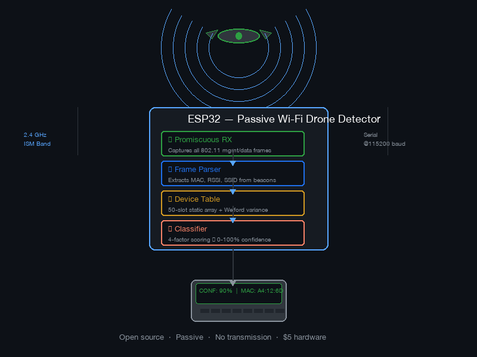
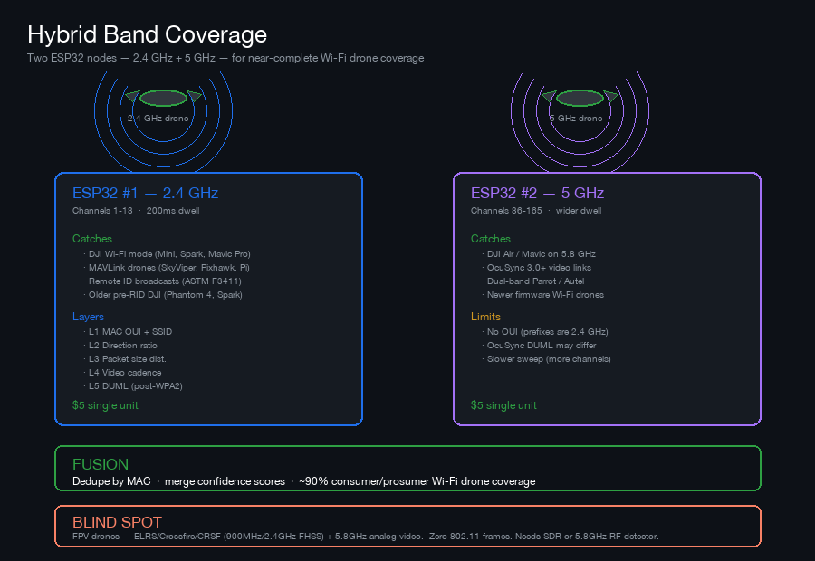
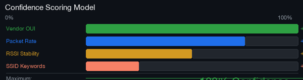
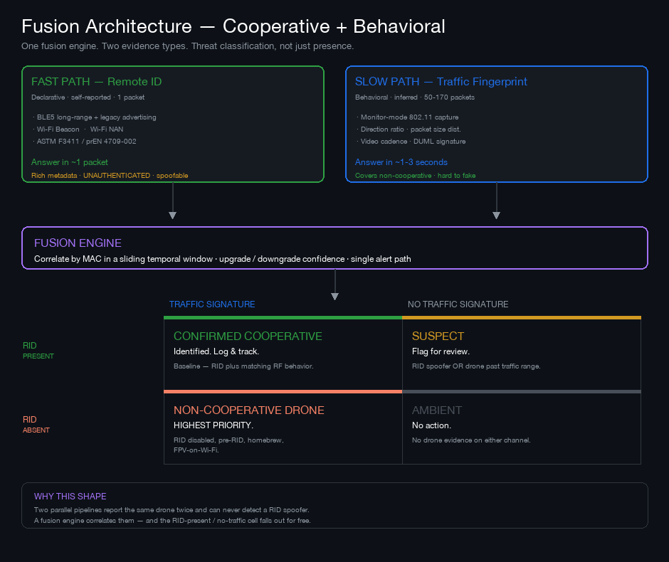

<!-- markdownlint-disable MD033 MD013 -->

<h1 align="center">ESP32 Passive Wi-Fi Drone Detector</h1>

<p align="center">
  <b>A $5 microcontroller that detects drones passively by listening to their Wi-Fi signals.</b><br>
  No radar. No jamming. No transmission. Just listen.
</p>

<p align="center">
  <a href="#quick-start">Quick Start</a> •
  <a href="#how-it-works">How It Works</a> •
  <a href="#confidence-scoring">Confidence Model</a> •
  <a href="#fusion-architecture">Fusion Design</a> •
  <a href="#alerting--getting-detections-to-a-phone">Alerting</a> •
  <a href="#roadmap">Roadmap</a>
</p>

<p align="center">
  
</p>

> ⚠️ **Status: Work in progress.** The single-node ESP32 detector (2.4 GHz, firmware + docs below) is a complete implementation of the source paper. The **fusion architecture** — combining Remote ID cooperative detection with behavioral traffic fingerprinting — is **design-stage and not implemented**. See [`docs/FUSION_DESIGN.md`](docs/FUSION_DESIGN.md) for current findings, open questions, and the build plan.

---

## What This Is

This is a complete implementation of the paper *"ESP32-Based Passive Wi-Fi Drone Detection with Confidence-Weighted Fingerprinting"* (IJRPR Vol 7, Issue 4, Apr 2026). It runs on any ESP32 microcontroller and detects consumer drones by capturing their 802.11 Wi‑Fi management frames in promiscuous mode.

**Three things make this interesting:**
- **$5 hardware.** You can build this for the price of a coffee.
- **Zero legal risk.** Passive receive-only. No jamming, no transmission, no FCC paperwork.
- **~5 KB RAM.** Tracks 50 devices simultaneously with no history buffers — using Welford's online variance algorithm.

---

## Quick Start

```bash
# 1. Clone the repo
git clone https://github.com/code4vectors-afk/esp32-drone-detector
cd esp32-drone-detector

# 2. Open firmware/esp32-drone-detector.ino in Arduino IDE

# 3. Select board: Tools → Board → ESP32 Dev Module

# 4. Connect ESP32 via USB and click Upload

# 5. Open Serial Monitor at 115200 baud → watch live reports
```

**No external libraries. No cloud services. No calibration.** Just the ESP32 Arduino Core.

---

## Hardware

| Item | Cost | Notes |
|------|------|-------|
| ESP32 dev board | $5–$15 | Any variant with WiFi (ESP32 DevKit, LOLIN D32, M5Stack Atom) |
| USB cable + power | — | Phone charger, power bank, or laptop USB port |
| External antenna (optional) | $5–$10 | RP-SMA 2.4 GHz improves range |

**That's the entire BOM for 2.4 GHz detection.**

### Hybrid: Two ESP32s for Full Band Coverage

<p align="center">
  
</p>

| ESP32 #1 | ESP32 #2 | Combined Coverage |
|----------|----------|-------------------|
| 2.4 GHz (channels 1-13) | 5 GHz (channels 36-165) | ~90% of consumer/prosumer Wi‑Fi drones |
| Catches: DJI Wi‑Fi mode, MAVLink, RID-enabled | Catches: DJI Air/Mavic on 5 GHz, OcuSync 3.0, newer firmware | **Near-complete Wi‑Fi drone coverage** |
| $5 | $5 | **$10 total** |

**What the hybrid catches that single-band misses:**
- DJI drones operating purely on 5 GHz (newer firmwares, some regions)
- OcuSync 3.0 and later (5 GHz exclusive video)
- Some Parrot and Autel dual-band drones

**What neither ESP32 catches:** FPV drones (ELRS/Crossfire/CRSF — zero 802.11 frames). Those require an SDR (HackRF/BladeRF) or 5.8 GHz RF detector.

---

## How It Works

<p align="center">
  
</p>

The system runs a **5‑module pipeline** on the ESP32 at 1 Hz:

### 1. Listen (Promiscuous RX)

The ESP32 places its Wi‑Fi radio in promiscuous mode — the same mode used for network packet sniffing. It cycles through all 13 Wi‑Fi channels (2.4 GHz) every 2.6 seconds, capturing every 802.11 management and data frame within range. **Extended mode:** switch to 5 GHz channel set (36-165) for extended band coverage.

### 2. Identify (Frame Parser)

Each captured frame is parsed for:
- **Source MAC address** — the device transmitting
- **RSSI** — received signal strength in dBm
- **SSID** — for beacon frames, the network name being broadcast
- **Frame type** — management vs data vs control
- **Packet size** — raw frame length in bytes

### 3. Track (Device Table)

A statically allocated array of 50 `DeviceStats` records (~96 bytes each = 4.7 KB total) maintains per-device state using **Welford's online algorithm** — which computes exact sample variance with three floating-point accumulators instead of a history buffer.

### 4. Score (Classifier)

Once per second, every active device receives a **0–100% confidence score** from five weighted factors.

### 5. Output

Serial output at 115200 baud, one report per second.

---

## Confidence Scoring — 5-Factor Model

Rebalanced weights from the original paper reduce reliance on MAC OUI (which can be randomized) and elevate traffic-pattern features (which cannot be spoofed without firmware modification).

| Factor | Points | What It Detects |
|--------|--------|-----------------|
| **1. Traffic Direction Ratio** | 25 | Drone sends 10-50× more data than controller. Asymmetry is intrinsic to the link design. |
| **2. Packet Size Distribution** | 25 | Bi‑modal: 56B controller → 1472B drone. Frame sizes are intrinsic to the link protocol. |
| **3. Vendor OUI** | 20 | MAC prefix matches DJI/Parrot/Autel. Not spoofable in real time — IEEE‑assigned, hardware‑burned. |
| **4. Video Frame Cadence** | 20 | ~33ms intervals (29.4 fps H.264 video). Timing of drone→controller flow. |
| **5. DUML Protocol Signature** | 10 | 0x55 delimiter + CRC-16 Kermit at known offsets (post‑WPA2 key capture). Protocol‑level signature. |

**Max score: 100.** Clamped at [0, 100].

| Score | Interpretation |
|-------|----------------|
| 80–100% | ✅ Almost certainly a drone. Alert. |
| 50–79%  | ⚠️ Likely a drone. Flag for review. |
| 10–49%  | 👀 Possible drone. Track only. |
| 0–9%    | 🔕 Ambient Wi‑Fi device. Ignore. |

### Current OUI Database

| OUI Prefix | Vendor | Devices |
|------------|--------|---------|
| `60:60:1F` | DJI | Phantom 4, Mini 3 |
| `A4:12:6D` | DJI | Mavic Air, Mavic Pro |
| `90:3A:E6` | Parrot | Anafi, Bebop |
| `AC:7B:A1` | Autel | EVO Lite, EVO Nano |
| `88:3A:DD` | TP‑Link | Control (false‑positive test) |
| `FC:FC:48` | Intel | Laptop NIC (false‑positive test) |

---

## Output Format

The system outputs one report per second over USB serial. Every line shows a detected device with all five confidence signals:

```
--- ESP32 Drone Detector ---
SSID: DJI-Mini-3Pro | Vendor: DJI | 42 pkt/s | RSSI: -61 dBm | Var: 2.14 | CONF: 90% | MAC: A4:12:6D:xx
SSID: (hidden) | Vendor: unknown | 3 pkt/s | RSSI: -75 dBm | Var: 12.40 | CONF: 0% | MAC: 88:3A:DD:xx
Frames: 1,247 | Channel: 7/13 | Slots: 2/50
------------------------------
```

Pipe to grep for alerts:

```bash
screen /dev/ttyUSB0 115200 | grep "CONF: 9[0-9]%|CONF: 100%"
```

---

## Deployment

| Metric | Value |
|--------|-------|
| Hardware cost (single ESP32) | $5–$15 |
| Hardware cost (hybrid 2× ESP32) | $10–$30 |
| Setup time | 15 minutes |
| Power draw | ~0.2 W (runs for days on USB battery) |
| Detection range | 50–150 m line of sight |
| Legal status | ⚖️ Passive receive‑only. No transmission. No licensing. |

### Cost Comparison

| Solution | Per‑Node | Power |
|----------|----------|-------|
| Commercial C‑UAS | $2,000–$50,000+ | 50–500 W |
| **ESP32 Passive Sniffer (single)** | **$5–$15** | **0.2 W** |
| **ESP32 Passive Sniffer (hybrid 2×)** | **$10–$30** | **0.4 W** |
| Multi‑node network (10×) | $50–$150 | 2 W |

**Caveat:** This does not replace a full counter‑UAS system. It does not jam, intercept, triangulate, or mitigate. What it does is **detect with high confidence at zero marginal cost** — enabling perimeter awareness where no detection capability currently exists.

---

## What We Can Detect, Exploit, and Package

**The 5‑layer model works across all Wi‑Fi drones, with or without Remote ID.**

| Layer | What It Detects | RID Enabled? | RID Disabled? |
|-------|----------------|--------------|---------------|
| 1. MAC OUI + SSID | Known vendor prefixes + drone AP names | Only DJI/Parrot/Autel with known OUI | **No** — MAC can be randomized; SSID may be hidden |
| 2. Traffic Direction Ratio | Drone sends 10-50× more than controller | ✅ Yes | ✅ **Yes** — asymmetry is protocol‑level |
| 3. Packet Size Distribution | Bi‑modal: 56B controller → 1472B drone | ✅ Yes | ✅ **Yes** — frame sizes are intrinsic |
| 4. Video Frame Cadence | ~33ms intervals (29.4 fps H.264) | ✅ Yes | ✅ **Yes** — video timing is universal |
| 5. DUML Protocol Signature | 0x55 delimiter + CRC-16 Kermit | ✅ Yes, if WPA2 captured | ✅ **Partially** — some newer drones have different DUML |

**Key insight:** Layers 2‑4 work on **every Wi‑Fi drone** regardless of Remote ID status. Layer 1 (OUI) is the only one that fails on RID‑disabled drones — but layers 2‑4 are stronger classifiers on their own.

### FPV & Homebrew Drones — ESP32 Blind Spots

The analysis above applies to Wi‑Fi drones. **FPV drones are invisible to the ESP32** — they use frequency‑hopping spread spectrum (900 MHz or 2.4 GHz FHSS) for control and 5.8 GHz analog or digital for video. The ESP32 sniffer emits **zero 802.11 frames** around them.

| Drone Type | Detectable By ESP32? | Primary Detection Vector |
|------------|----------------------|------------------------|
| ExpressLRS / Crossfire / CRSF (900 MHz or 2.4 GHz FHSS) | **No** | HackRF / BladeRF (SDR) |
| Analog video (5.8 GHz NTSC/PAL) | **No** (presence only) | 5.8 GHz RF power detector |
| Digital FPV (Walksnail, HDZero, DJI FPV) | **No** (no 802.11) | SDR + protocol‑specific decoder |
| MAVLink over Wi‑Fi (Raspberry Pi/ESP32 companion) | ✅ Yes | 1Hz heartbeat in plaintext UDP — 100 % ID from one packet |
| Homebrew with MAVLink + Remote ID module | ✅ Yes | MAVLink UDP stream + RID broadcast |

**The hardest detection problem:** An FPV drone on ELRS (900 MHz FHSS) with analog video (5.8 GHz NTSC). No Wi‑Fi, no BLE, no Remote ID. Detection requires a 5.8 GHz RF energy detector (presence only) or an SDR with FHSS tracking capability.

**Multi‑modal detection stack (recommended):**
- One ESP32 (Wi‑Fi drones, MAVLink, Remote ID) — $5
- One $10 RTL‑SDR dongle with 5.8 GHz antenna (FPV video presence) — $10
- One HackRF (OcuSync DroneID decode, FHSS tracking) — $30‑$300

**Total BOM per node: ~$50‑$150** for broad coverage across all drone types.

### Drones Without Remote ID — Detection Table

| Drone Type | Remote ID? | ESP32 Detection? | Primary Vector |
|------------|------------|------------------|----------------|
| DJI Mini 3/4 (Wi‑Fi) | Yes (FAA‑compliant) | Yes — RID broadcast + Wi‑Fi AP | ESP32 + 5.8 GHz Rx |
| DJI Mavic 3 (OcuSync) | Yes (embedded in OcuSync) | Not via Wi‑Fi — DroneID in SDR signal | HackRF (luyii‑code‑1 2026) |
| Older DJI (Phantom 4, Spark) | No (pre‑RID firmware) | Yes — Wi‑Fi AP active | ESP32 traffic analysis |
| FPV homebrew (ELRS + analog) | No (unless module added) | No — no Wi‑Fi at all | 5.8 GHz RF detector + SDR |
| Homebrew + Pi (MAVLink) | Optional (can add RID module) | Yes — MAVLink UDP stream | ESP32 heartbeat = 100 % ID |
| Custom built with FCC module | Depends on firmware | Maybe — depends on telemetry radio | Multi‑modal |

---

## Fusion Architecture

> **Design stage — not implemented.** Full findings, open questions, and build plan: [`docs/FUSION_DESIGN.md`](docs/FUSION_DESIGN.md)

<p align="center">
  
</p>

### The Problem With Two Parallel Pipelines

Remote ID and traffic fingerprinting are not two modes of one sensor. They are two *categories of evidence*:

| | Remote ID | Traffic Fingerprint |
|---|---|---|
| Evidence type | **Declarative** — self-reported | **Behavioral** — inferred |
| Time to answer | ~1 packet (instant) | 50–170 packets (~1–3 s) |
| Coverage | Cooperative drones only | Cooperative **and** non-cooperative |
| Spoofable | **Trivially** | Requires emulating a drone RF profile |
| Metadata | Rich: ID, operator location | Rich post-WPA2: telemetry, video |

Two disconnected pipelines produce double reporting (one alert per pipeline for the same aircraft), inconsistent confidence scales, and — critically — **no ability to detect a Remote ID spoofer**. RID is a broadcast, not an authenticated handshake; open-source spoofers generate valid ASTM F3411 payloads that appear as legitimate aircraft on compliant receivers.

A single fusion engine correlates both by MAC inside a sliding window and resolves to one classification and one alert.

### The Classification Matrix

| | **Traffic signature present** | **No traffic signature** |
|---|---|---|
| **RID present** | ✅ **Confirmed cooperative drone** — identified, near. Log and track. | ⚠️ **Suspect** — most likely out of behavioral range, or a spoofer. Flag, do not alert. |
| **RID absent** | 🔴 **Non-cooperative drone** — highest priority. RID disabled, pre-RID, homebrew, or FPV-on-Wi-Fi. | 🔕 Ambient. No action. |

**The bottom-left cell is the reason for this work.** It is the drone that does not wish to be seen — and it is exactly what a Remote ID-only system cannot detect.

**The top-right cell is the bonus** that two disconnected pipelines can never produce.

### The Range Asymmetry — Read Before Interpreting the Matrix

| Signal | Practical reach |
|--------|----------------|
| Wi-Fi Remote ID | **1–5 miles** |
| BLE Remote ID | 100–300 m |
| Behavioral traffic capture | **~50–150 m** |

The behavioral layer sees roughly an order of magnitude less distance than Wi-Fi RID. **A RID detection with no traffic signature almost always means "the drone is far away," not "someone is spoofing."** Spoofer detection only becomes credible when the RID signal is strong enough to imply local origin.

The near-term value of the traffic layer is therefore **proximity validation** — telling you which of your RID contacts are actually nearby — plus non-cooperative detection.

### Integration Notes

The existing DroneAware node already runs a **monitor-mode Wi-Fi adapter** (ALFA AWUS036ACS or Panda PAU0B) alongside a **separate BLE dongle** (Sena UD100). RID beacons are one frame type among all 802.11 frames that adapter already sees — so the radio architecture for behavioral analysis is already in place.

The real constraint is **channel dwell**. Hopping channels to hunt RID beacons means observing roughly 1/13 of any given drone's traffic. Retune cost varies sharply by adapter (22 ms on the RTL8821AU vs 1007 ms on the MT7612U), and a community bench measured RID capture improving from **51% → 72%** purely by swapping adapters.

**Recommended:** add a dedicated ~$25 monitor-mode adapter for the traffic layer rather than degrade the node's own RID capture.

The node software is licensed with a defined collection scope, and binaries are Sigstore-attested. **Extend by consuming the local API, not by modifying the feeders** — that keeps the node stock and the attestation valid.

---

## Alerting — Getting Detections to a Phone

> Full setup guide: [`docs/ALERTING.md`](docs/ALERTING.md) · Dispatcher: [`scripts/alert.py`](scripts/alert.py)

**Carrier email-to-SMS gateways are dead or dying.** T-Mobile (`@tmomail.net`) retired ~Dec 2024 and AT&T (`@txt.att.net`) shut down ~Jun 2025 — both fail *silently*, so an alert system built on them looks healthy while delivering nothing. Verizon (`@vtext.com`) still works but retires 31 Mar 2027.

**Use a push service for the primary channel and a paid SMS API for redundancy.**

| Channel | Cost | Escalates until ack? |
|---------|------|---------------------|
| **ntfy** | Free, self-hostable | No |
| **Pushover** | $5 one-time | ✅ **Priority 2 repeats every 60s until acknowledged** |
| **Twilio SMS** | ~$0.008/msg | No |
| Carrier gateway | Free | ❌ Largely dead — see above |

**Why this matters:** an SMS is a *notification*. It arrives, it makes a sound, and it stops. Pushover priority 2 **bypasses Do Not Disturb and re-alerts until someone acknowledges.** For "wake me up because a drone is inbound," that is the difference between an alert and a notification. SMS stays as the redundant path because it travels a different network than an IP push.

### Severity maps to the fusion matrix

| Fusion cell | Severity |
|-------------|----------|
| RID + traffic (confirmed cooperative) | `info` — log it, do not wake anyone |
| RID only, no traffic | **none** — range asymmetry means this is usually *distant*, not suspicious |
| **No RID + traffic** (non-cooperative) | **`critical`** |
| Node offline / adapter failure | `alert` |

```bash
# The threat case
./scripts/alert.py --severity critical \
  --title "Non-cooperative drone" \
  --message "CONF 92% | MAC A4:12:6D:xx | ch 6 | -58 dBm"
```

Rate limiting suppresses repeat alerts on the same key, but **severity escalation always breaks through** — a contact going from suspicious to confirmed must not be swallowed by a cooldown.

**Verified working:** ntfy delivery end-to-end (HTTP 200, message read back), all four rate-limiter behaviours, exit codes, dry-run. **Untested:** Twilio, Pushover, email — implemented but no credentials configured yet.

---

## Project Structure

```
esp32-drone-detector/
├── firmware/
│   └── esp32-drone-detector.ino    ← The code. Flash this to your ESP32.
├── scripts/
│   └── alert.py                    ← Multi-channel alert dispatcher (ntfy/SMS/push)
├── docs/
│   ├── SPEC.md                     ← Reverse‑engineered architecture spec
│   ├── TECHNICAL_BRIEF.md          ← Full team engineering briefing
│   ├── FUSION_DESIGN.md            ← ⚠️ WIP: fusion design, findings, open questions
│   ├── ALERTING.md                 ← Alert channels, carrier gateway status, setup
│   ├── ESP32_Drone_Detector_Executive_Summary.pdf ← 3‑page exec overview
│   └── Drone_Traffic_Fingerprinting_Deep_Analysis.pdf ← 6‑page deep analysis
├── assets/
│   ├── architecture.png            ← System diagram
│   ├── confidence_model.png        ← Scoring visual
│   ├── hybrid_approach.png         ← 2‑ESP32 band coverage diagram
│   └── fusion_architecture.png     ← Cooperative + behavioral fusion design
└── README.md                       ← You are here
```

---

## Roadmap

| Phase | Capability | Status |
|-------|------------|--------|
| **1 — Single‑node detector** | 2.4 GHz, 4‑factor confidence model — matches source paper | ✅ Done |
| **2 — 5‑layer model** | Rebalanced weights: direction ratio + packet size + timing elevated above OUI | 🔜 Next |
| **3 — OUI + band expansion** | 50+ fingerprints, 5 GHz channel set | 📅 |
| **4 — Hybrid two‑node** | 2× ESP32: 2.4 GHz + 5 GHz for full band coverage | 📅 |
| **5 — Fusion design** | Remote ID + behavioral in one engine. See [`docs/FUSION_DESIGN.md`](docs/FUSION_DESIGN.md) | 🟡 **WIP — design stage** |
| **6 — WPA2 key capture** | Log 4‑way handshake, post‑process DUML protocol | 📅 |
| **7 — ML classification** | TinyML across traffic layers for false‑positive reduction | 📅 |
| **8 — Beyond Wi‑Fi** | MAVLink / CRSF / ELRS signature recognition, SDR for FPV | 📅 |

**Open work is tracked in [`docs/FUSION_DESIGN.md` §7 (Open Questions)](docs/FUSION_DESIGN.md).** The blocking item is confirming what the DroneAware node's local `api.py` exposes.

---

## References

**Primary source**
- **Original paper:** Meet Patel, Tejas Patil, Jatin Solanki, Hrushikesh Vibhute — *ESP32-Based Passive Wi-Fi Drone Detection with Confidence-Weighted Fingerprinting*. IJRPR Vol 7(4), Apr 2026. [PDF](https://ijrpr.com/uploads/V7ISSUE4/IJRPR62362.pdf)

**Protocol reverse engineering**
- **Christof, T.** (2021). *DJI Wi-Fi Protocol Reverse Engineering.* JKU Linz MSc thesis. Four-layer protocol architecture, full packet structure, payload encryption analysis. [PDF](https://www.digidow.eu/publications/2021-christof-masterthesis/Christof_2021_MasterThesis_DJIProtocolReverseEngineering.pdf)
- **Behind The Wings** (2023). *Reverse Engineering and Drone Hijacking in DJI Enhanced Wi-Fi Protocol.* arXiv:2309.05913. [PoC](https://github.com/ibndias/dji-drone-hijacking)
- **luyii-code-1** (2026). *DJI OcuSync DroneID Research* — O2/O4 PHY, packet, and cryptographic analysis. [GitHub](https://github.com/luyii-code-1/dji-ocusync-droneid-research)

**Encrypted traffic classification**
- **Sciancalepore et al.** (2019). *Detecting Drones Status via Encrypted Traffic Analysis.* ACM WiSec.
- **Bisio et al.** (2018). *Unauthorized Amateur UAV Detection Based on WiFi Statistical Fingerprint Analysis.* IEEE.

**Remote ID / cooperative detection**
- **ASTM F3411-19** — *Standard Specification for Remote ID and Tracking.* [PDF](https://thedroneprofessor.com/wp-content/uploads/2022/11/F3411.40165-UAS-Remote-ID.pdf)
- **Open Drone ID** — *opendroneid-core-c* reference library. [GitHub](https://github.com/opendroneid/opendroneid-core-c)
- **DroneAware Network** — community Remote ID receiver network; node build guide and hardware list. [droneaware.io](https://droneaware.io/build-a-raspberry-pi-remote-id-receiver.html) · [node releases](https://github.com/fduflyer/DroneAware-Node-Releases)

**Adversarial considerations**
- **droneRemoteIDSpoofer** — demonstrates unauthenticated RID broadcast vulnerability. [GitHub](https://github.com/DavidAlexanderW/droneRemoteIDSpoofer)

**Algorithms**
- **Welford, B.P.** (1962). *Note on a Method for Calculating Corrected Sums of Squares and Products.* Technometrics 4(3), 419-420.
- **IEEE 802.11-2020** — IEEE Standard for Information Technology.

---

<p align="center">
  <sub>Reverse-engineered and implemented by <b>C4C Engineering</b>.</sub><br>
  <sub>Open source. Passive. No transmission. $5 hardware.</sub>
</p>